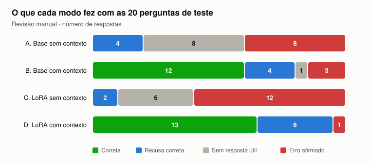

# Relatório de avaliação — Assistente de Conhecimento Interno (Porto Ventura Terminais)

Gerado por `assistente/relatorio.py` a partir de `results/respostas.json` e `results/revisao_manual.json`. Conjunto de teste: 20 perguntas, sendo 14 com resposta na base e 6 fora da base. Cada célula mostra *acertos/total (%)*; o total muda conforme o critério (14 perguntas na base, 6 fora da base, 20 no geral ou só as recusas).

## 1. Matriz critério × modo

Os quatro critérios de aceitação do projeto, cada um medido por métricas automáticas (calculadas pelo avaliador contra o gabarito) e manuais (revisão de cada resposta, em `results/revisao_manual.json`).

| Critério / métrica | A. Base sem contexto | B. Base com contexto | C. LoRA sem contexto | D. LoRA com contexto |
|---|---:|---:|---:|---:|
| **1. Respostas baseadas na fonte** | | | | |
| Cita a fonte certa (perguntas na base) | 0/14 (0%) | 8/14 (57%) | 0/14 (0%) | 13/14 (93%) |
| Cita uma fonte errada | 0/14 (0%) | 1/14 (7%) | 0/14 (0%) | 0/14 (0%) |
| Responde sem citar fonte (das que responderam) | 10/10 (100%) | 4/13 (31%) | 12/12 (100%) | 1/14 (7%) |
| Recusa com fonte espúria anexada | 0/8 (0%) | 5/5 (100%) | 0/4 (0%) | 6/6 (100%) |
| **2. Redução de alucinação** | | | | |
| Taxa de alucinação (automática) | 12/20 (60%) | 3/20 (15%) | 15/20 (75%) | 3/20 (15%) |
| Inventou informação que não existe na base (manual) | 8/20 (40%) | 0/20 (0%) | 12/20 (60%) | 0/20 (0%) |
| Usou mal o contexto: trecho da base que não responde (manual) | 0/20 (0%) | 3/20 (15%) | 0/20 (0%) | 1/20 (5%) |
| Respondeu pergunta fora da base (automática) | 2/6 (33%) | 2/6 (33%) | 4/6 (67%) | 0/6 (0%) |
| **3. Relevância e precisão** | | | | |
| Acerto nas perguntas da base (automático) | 0/14 (0%) | 12/14 (86%) | 0/14 (0%) | 11/14 (79%) |
| Acerto nas perguntas da base (manual) | 0/14 (0%) | 12/14 (86%) | 0/14 (0%) | 13/14 (93%) |
| Fatos do gabarito cobertos | 0/17 (0%) | 15/17 (88%) | 1/17 (6%) | 14/17 (82%) |
| Respostas vagas ou sem a regra (manual) | 4/20 (20%) | 0/20 (0%) | 4/20 (20%) | 0/20 (0%) |
| **4. Uso correto do contexto** | | | | |
| Recusa correta (perguntas fora da base) | 4/6 (67%) | 4/6 (67%) | 2/6 (33%) | 6/6 (100%) |
| Recusa indevida (perguntas na base) | 4/14 (29%) | 1/14 (7%) | 2/14 (14%) | 0/14 (0%) |
| Acerto geral (automático) | 4/20 (20%) | 16/20 (80%) | 2/20 (10%) | 17/20 (85%) |
| Respostas úteis: corretas + recusas corretas (manual) | 4/20 (20%) | 16/20 (80%) | 2/20 (10%) | 19/20 (95%) |
| **Comportamento** | | | | |
| Tamanho médio da resposta (palavras) | 65 | 20 | 46 | 17 |

## 2. Como cada modo se comporta em cada critério, e por quê

Antes dos números, um ponto de leitura: com 20 perguntas, cada pergunta vale 5 pontos percentuais no geral e 7 pontos nas 14 perguntas da base. Por isso as conclusões abaixo se apoiam nas diferenças grandes e no **tipo de erro** de cada modo, identificado na revisão manual, mais do que em diferenças de uma pergunta.

### Critério 1 — Respostas baseadas na fonte

| Modo | Comportamento | Por quê |
|---|---|---|
| A e C | nunca citam fonte | sem contexto não há documento para citar, e o prompt sem grounding não pede citação |
| B | cita a fonte certa em 8 de 14; responde sem fonte 4 vezes e cita a fonte errada 1 vez (A07, POL-08 no lugar de POL-03) | a regra de citar está só no prompt de sistema, e o modelo base a segue de forma irregular. Na A07, a resposta veio do 1º trecho (POL-03, EPI), mas ele citou o 2º (POL-08, banco de horas), que não tinha relação com a pergunta |
| D | cita a fonte certa em 13 de 14 | os 30 exemplos de treino com resposta terminam em `[Fonte: POL-NN]`; o LoRA fixou o formato |

**Efeito colateral nos dois modos com contexto:** todas as recusas de B e D vêm com uma fonte anexada que não faz sentido, como `[Fonte: POL-XX]` ou `[Fonte: ADM-05]` (documento que não existe). A causa é o prompt de sistema, que manda *sempre* terminar com a fonte, inclusive quando a resposta é a recusa. O LoRA não corrigiu isso porque o prompt continuou o mesmo. A correção proposta é uma guarda de saída que remove a fonte das recusas e só aceita IDs presentes nos trechos recuperados.

### Critério 2 — Redução de alucinação

A taxa automática de alucinação é igual em B e D (15%), mas a revisão manual mostra que **a natureza do erro é diferente** em cada modo:

| Tipo de erro (revisão manual) | A | B | C | D |
|---|---:|---:|---:|---:|
| Inventou informação que não existe na base | 8 | 0 | 12 | 0 |
| Usou um trecho da base que não responde a pergunta | 0 | 3 | 0 | 1 |
| Resposta vaga, sem fato concreto | 4 | 0 | 2 | 0 |

- **Grounding zera a invenção (A → B: de 8 para 0).** Quando a resposta está no contexto, o modelo copia o trecho em vez de gerar a partir da memória paramétrica. Como a empresa é fictícia, essa memória não tem nada de verdadeiro sobre ela, e tudo o que o modelo "lembra" é invenção plausível: 24 horas no pátio IMO, 30 a 45 dias de free time, 15 dias de licença-paternidade.
- **O erro que sobra com grounding é usar mal o contexto.** B não inventa números, mas responde com o trecho errado: na A18 (licença-paternidade), a busca trouxe três trechos fracos (pontuação 3,6 ou menos), e o modelo respondeu com o 3º, as regras de férias do POL-08. Na A17 (devolução de notebook), o 1º trecho fala do notebook fornecido no trabalho híbrido, e o modelo respondeu com o 2º, o prazo de 24 horas para comunicar a perda da credencial (POL-02).
- **O LoRA reduz esse uso indevido (B → D: de 3 para 1)** porque foi treinado com 10 exemplos em que o contexto recuperado *não* respondia a pergunta e o alvo era a recusa.
- **O LoRA sem contexto aumenta a invenção (A → C: de 8 para 12).** O adapter aprendeu um estilo: respostas curtas, afirmativas e com um fato concreto, porque todo alvo de treino era assim. Sem contexto, não há fato para copiar, e o modelo preenche o formato com fatos plausíveis: "0800 721 3456", "navios entre 105 e 120 metros", "R$ 20,00 no Rio Grande do Sul". Ao mesmo tempo, ele perdeu metade das recusas genéricas que o modelo base fazia (de 8 para 4), porque a única recusa que aprendeu está ligada ao formato com contexto.

### Critério 3 — Relevância e precisão

| Modo | Acerto na base (automático → manual) | Por quê |
|---|---|---|
| A e C | 0 de 14 → 0 de 14 | o conhecimento não existe nos pesos do modelo. 30 exemplos e 3 épocas de LoRA não bastam para "decorar" 8 políticas, e as perguntas de teste são diferentes das de treino |
| B | 12 de 14 → 12 de 14 | a busca pôs o documento certo no contexto em 14 de 14 perguntas (`results/avaliacao_busca.json`). Por isso **todo erro de B e D na base é de geração, não de recuperação** |
| D | 11 de 14 → 13 de 14 | as respostas de D são as mais curtas (17 palavras em média). A01 ("Não, ele já foi considerado perdido") e A04 ("1 mês") estão certas, mas sem o fato literal do gabarito, e o avaliador automático as marca como erradas |

O único erro real de D é a A07: a pergunta era sobre a proteção **extra** do cais (protetor auricular), e D listou o EPI geral do pátio. Os dois estão na mesma seção do POL-03, e o modelo pegou a lista errada. É um erro de precisão entre trechos vizinhos, não de invenção.

### Critério 4 — Uso correto do contexto

O uso correto do contexto tem dois lados: **recusar o que não está lá** e **não recusar o que está lá**.

| Modo | Recusa correta (fora da base) | Recusa indevida (na base) | Leitura |
|---|---:|---:|---|
| A | 4 de 6 | 4 de 14 | recusa muito, dos dois lados. As recusas são genéricas ("não tenho informações") e às vezes vêm com contatos inventados, como o site da A19 |
| B | 4 de 6 | 1 de 14 | recusa pouco quando deveria: o modelo base tende a "aproveitar" o contexto. A seção 7 mostra que, na A17 e na A18, a busca trouxe trechos com palavras em comum, mas sem a resposta, e o modelo respondeu com eles |
| C | 2 de 6 | 2 de 14 | o pior dos dois lados |
| D | **6 de 6** | **0 de 14** | recusa exatamente quando deve |

O dado mais importante deste critério: **D melhorou os dois lados ao mesmo tempo.** Se o LoRA tivesse só aprendido a "recusar mais", a recusa indevida teria subido. Ela caiu de 1 para 0: a A14, que B recusou mesmo com a resposta no contexto, D respondeu certo. Isso indica que o modelo aprendeu a **verificar se o contexto responde a pergunta**, que é o comportamento treinado: os exemplos de treino trazem o mesmo tipo de contexto da busca, às vezes relevante e às vezes não.

## 3. A relação entre alucinação e precisão

### A taxa de alucinação sozinha engana

A taxa de alucinação calculada sobre as 20 perguntas mistura **duas decisões** do modelo:

1. **responder ou recusar;**
2. **quando responde, acertar ou errar.**

Um modelo que recusasse tudo teria 0% de alucinação, e também 0% de utilidade: acertaria só as 6 perguntas fora da base e nenhuma das 14 que o funcionário precisa ver respondidas. Por isso a alucinação só tem sentido lida **junto** com a precisão e a cobertura. A tabela abaixo separa as duas decisões:

| Modo | Respondeu (não recusou) | Precisão das respostas dadas | Alucinação nas respostas dadas | Cobertura da base | Recusas corretas / recusas |
|---|---:|---:|---:|---:|---:|
| A. Base sem contexto | 12/20 (60%) | 0/12 (0%) | 8/12 (67%) | 0/14 (0%) | 4/8 (50%) |
| B. Base com contexto | 15/20 (75%) | 12/15 (80%) | 3/15 (20%) | 12/14 (86%) | 4/5 (80%) |
| C. LoRA sem contexto | 16/20 (80%) | 0/16 (0%) | 12/16 (75%) | 0/14 (0%) | 2/4 (50%) |
| D. LoRA com contexto | 14/20 (70%) | 13/14 (93%) | 1/14 (7%) | 13/14 (93%) | 6/6 (100%) |

- **Precisão das respostas dadas:** quando o modo responde, quantas vezes acerta. É o que o funcionário experimenta.
- **Alucinação nas respostas dadas:** quando o modo responde, quantas vezes afirma algo errado (inventa ou usa um trecho que não responde).
- **Cobertura da base:** das 14 perguntas que têm resposta, quantas foram respondidas certo.

A alucinação total é o produto das duas decisões: *proporção de perguntas respondidas × alucinação nas respostas dadas*.

| Modo | Responde | × Erra quando responde | = Erro afirmado no total |
|---|---:|---:|---:|
| A | 60% | 67% | 40% (8/20) |
| B | 75% | 20% | 15% (3/20) |
| C | 80% | 75% | 60% (12/20) |
| D | 70% | 7% | **5% (1/20)** |

### O que a relação mostra em cada modo

- **A e C: precisão e alucinação não estão em equilíbrio, as duas estão no pior ponto.** A precisão é 0% porque o conhecimento não existe no modelo. Nesse cenário, o único jeito de alucinar menos é responder menos: A recusa 8 vezes e erra 8; C recusa só 4 e erra 12. A diferença entre A e C não é de conhecimento (os dois sabem zero), é de **disposição para responder**, e o LoRA aumentou essa disposição sem dar o conhecimento.
- **A → B: o grounding move as duas métricas na direção certa ao mesmo tempo.** A precisão vai de 0% para 80%, e a alucinação nas respostas dadas cai de 67% para 20%. Não há troca entre as duas, porque o que mudou foi a **origem da resposta**: ela deixa de vir da memória do modelo e passa a vir do documento.
- **B → D: o LoRA melhora a calibração, isto é, a decisão de quando responder.** D respondeu exatamente 14 vezes, o mesmo número de perguntas que têm resposta na base, e acertou 13. B errou a decisão nos dois sentidos: respondeu 2 perguntas que deveria recusar e recusou 1 que deveria responder. Com a decisão certa, a precisão sobe para 93% e a alucinação nas respostas dadas cai para 7%.

Em resumo, **o grounding resolve a precisão, e o LoRA resolve a calibração.** As duas camadas juntas levam o erro afirmado de 40% (A) para 5% (D).

### Nem todo erro custa igual: perguntas de risco alto

Das 14 perguntas da base, 5 tratam de temas em que uma resposta errada pode causar acidente, multa ou responsabilização: EPI, velocidade no pátio, carga perigosa, controle de acesso e registro de avaria (campo `risco` em `data/perguntas.json`). A tabela mostra como cada modo respondeu a essas 5; ⚠️ marca as respostas erradas afirmadas como certas.

| ID | Pergunta | A | B | C | D |
|---|---|---|---|---|---|
| A06 | O que acontece se eu emprestar minha credencial para um colega? | vaga (sem fato concreto) | correta | ⚠️ inventou informação | correta |
| A07 | Que proteção extra é exigida no cais durante o embarque? | vaga (sem fato concreto) | correta | vaga (sem fato concreto) | ⚠️ usou mal o contexto |
| A08 | Qual o limite de velocidade dentro dos armazéns? | recusa indevida | correta | recusa indevida | correta |
| A11 | Qual o prazo para concluir o registro de uma avaria no sistema? | recusa indevida | correta | ⚠️ inventou informação | correta |
| A12 | Por quanto tempo uma carga perigosa pode ficar no pátio IMO? | ⚠️ inventou informação | correta | ⚠️ inventou informação | correta |
| | **Respostas erradas afirmadas como certas** | **1/5** | **0/5** | **3/5** | **1/5** |

- **C** afirma, por exemplo, que carga perigosa pode ficar só 24 horas no pátio IMO e que emprestar a credencial "não traz nenhuma alteração". São erros que levam a uma ação errada.
- **B** acertou as 5.
- **D**, o melhor modo no geral, errou justamente uma delas: na A07, listou o EPI geral e omitiu o protetor auricular exigido no cais.

Isso mostra que **93% de precisão no geral não garante 100% nos temas críticos**. Com 5 perguntas de risco alto, a diferença entre B e D é de uma resposta e não permite dizer que um modo é mais seguro que o outro. A conclusão que vale é que temas de segurança precisam de uma proteção adicional, independente da precisão média (ver seção 4).

### Efeito de cada camada

A seção 6 conta as perguntas que passaram a ter (ou deixaram de ter) resposta útil: **o grounding vale +12, o LoRA sobre o grounding vale +3 e o LoRA sem grounding vale −2.**

1. **Grounding é o que traz a precisão e elimina a invenção.** É a camada que conecta a IA aos dados da empresa.
2. **O fine-tuning ajusta o comportamento (calibração, citação, formato) e só ajuda em cima do grounding.** Sozinho, aumenta a disposição de responder sem dar o conhecimento, e por isso piora a alucinação.
3. **Na arquitetura recomendada (D), os erros restantes não são invenções.** São uma escolha errada entre trechos parecidos (A07) e fontes anexadas às recusas, ambos tratáveis com mais exemplos de treino e uma guarda de saída.

## 4. Implicações para um ambiente corporativo

**1. A arquitetura: grounding é obrigatório; fine-tuning é opcional e vem depois.**
O conhecimento da empresa deve ficar na base de documentos, não nos pesos do modelo. O modo C mostra o risco do caminho contrário: um modelo treinado com exemplos da empresa, mas sem acesso aos documentos, responde com a confiança de quem conhece a empresa e com a precisão de quem não conhece. O fine-tuning se justifica para padronizar o comportamento (citar, recusar, ser objetivo), sempre sobre o grounding.

**2. O indicador certo não é só a taxa de alucinação.**
Um painel de produção precisa de, no mínimo, quatro números lidos juntos:
- **precisão das respostas dadas:** a confiança do funcionário no que lê;
- **cobertura:** quanto da base o assistente consegue responder;
- **taxa de recusa:** quanto o funcionário fica sem resposta;
- **erro afirmado em temas críticos:** o risco operacional.

Como a seção anterior mostrou, cortar a alucinação recusando tudo melhora um indicador e destrói os outros.

**3. Errar custa mais do que recusar, e o custo depende do tema.**
- Uma **recusa** custa tempo: o funcionário pergunta à área responsável.
- Uma **resposta errada afirmada como certa** pode virar ação: um caminhão que perde a janela, um contêiner de carga perigosa fora do prazo, alguém sem protetor auricular no cais.

Por isso, num ambiente real, os temas devem ser classificados por risco. Nos de risco alto (SSMA, carga perigosa, acesso, aduaneiro), a resposta deve mostrar o trecho literal da política com o link para o documento e indicar a área responsável. Se a guarda de saída não validar a fonte, o assistente recusa e encaminha.

**4. As recusas são um sinal de lacuna na documentação.**
As 6 perguntas fora da base (auxílio-creche, licença-paternidade, devolução de notebook, telefone do despachante) são dúvidas plausíveis de funcionários para as quais não existe política escrita. Em produção, registrar as perguntas recusadas gera uma lista priorizada do que o RH e as áreas precisam documentar. O assistente passa a melhorar a própria base.

**5. Manutenção sem retreino, com teste de regressão.**
Uma política alterada exige só editar o documento e reindexar a busca. Não é preciso retreinar o modelo. O conjunto de teste com gabarito e os scripts deste projeto (`avaliar_busca.py`, `reavaliar.py`) funcionam como teste de regressão: antes de publicar uma versão nova da base ou do modelo, roda-se a avaliação e compara-se com a anterior, como foi feito aqui ao corrigir o avaliador.

**6. Rastreabilidade: a citação precisa ser verificada, não só exibida.**
Citar a fonte é o que permite ao funcionário e à auditoria conferir a resposta. Mas o modelo também anexou fontes inexistentes às recusas (ADM-05, POL-XX). Num sistema real, a citação só pode ser mostrada se o ID estiver entre os trechos efetivamente recuperados. Caso contrário, uma citação falsa dá credibilidade a uma resposta errada.

**7. Invenções podem virar risco de segurança da informação.**
Sem grounding, o modelo inventou um telefone ("0800 721 3456") e sites ("www.portoventura.pt", "www.portoventura.com.br"). Num assistente interno, um contato inventado pode levar um funcionário a ligar ou entrar num site que não pertence à empresa, uma porta para fraude e engenharia social. É mais um motivo para não colocar um modelo sem grounding diante dos funcionários.

**8. Custo e privacidade.**
O modelo usado tem 1,5 bilhão de parâmetros, roda quantizado em 4 bits numa GPU T4 de 15 GB e responde em segundos. Isso permite hospedar o assistente na infraestrutura da própria empresa, sem enviar documentos internos a serviços externos, o que importa para a LGPD e para informações comerciais. Em produção, a busca também precisaria filtrar os documentos pelo perfil de quem pergunta, porque nem toda política pode ser vista por todos.

**9. O que este teste ainda não garante.**
São 20 perguntas, 5 delas de risco alto, numa base de 8 documentos. Os resultados indicam a direção com segurança: grounding × sem grounding é uma diferença grande e consistente. As diferenças pequenas, como B × D na base, ainda não estão comprovadas. Antes de uma implantação, o conjunto de teste deveria crescer por área, com perguntas reais de funcionários e uma amostra das respostas revisada por pessoas a cada nova versão.

## 5. Resultado por pergunta

Categoria automática em cada célula; quando a revisão manual discorda ou detalha o erro, o rótulo manual aparece em itálico.

| ID | Pergunta | Fonte | A | B | C | D |
|---|---|---|---|---|---|---|
| A01 | Meu motorista chegou 40 minutos depois do fim da janela. Ele ainda pode entrar? | POL-01 | ⛔ recusa indevida | ❌ incorreta *usou mal o contexto* | ❌ incorreta *conclusão certa sem a regra* | ❌ incorreta *correta com outras palavras* |
| A02 | Quais documentos o motorista apresenta na chegada ao gate? | POL-01 | ❌ incorreta *inventou informação* | ✅ correta | 🟡 incompleta *inventou informação* | ✅ correta |
| A03 | O que acontece com a transportadora que falta aos agendamentos sem cancelar? | POL-01 | ❌ incorreta *inventou informação* | ✅ correta | ❌ incorreta *inventou informação* | ✅ correta |
| A04 | Quanto tempo vale uma credencial temporária de prestador? | POL-02 | ❌ incorreta *inventou informação* | ✅ correta | ❌ incorreta *inventou informação* | ❌ incorreta *correta com outras palavras* |
| A05 | Com quantos dias de antecedência o gestor deve pedir a credencial de um terceirizado? | POL-02 | ❌ incorreta *inventou informação* | ✅ correta | ❌ incorreta *inventou informação* | ✅ correta |
| A06 | O que acontece se eu emprestar minha credencial para um colega? | POL-02 | ❌ incorreta *vaga (sem fato concreto)* | ✅ correta | ❌ incorreta *inventou informação* | ✅ correta |
| A07 | Que proteção extra é exigida no cais durante o embarque? | POL-03 | ❌ incorreta *vaga (sem fato concreto)* | ✅ correta | ❌ incorreta *vaga (sem fato concreto)* | ❌ incorreta *usou mal o contexto* |
| A08 | Qual o limite de velocidade dentro dos armazéns? | POL-03 | ⛔ recusa indevida | ✅ correta | ⛔ recusa indevida | ✅ correta |
| A09 | Quantos dias de free time tem um contêiner de exportação? | POL-04 | ❌ incorreta *inventou informação* | ✅ correta | ❌ incorreta *inventou informação* | ✅ correta |
| A10 | Cliente com crédito aprovado tem quanto tempo para pagar a armazenagem? | POL-04 | ❌ incorreta *vaga (sem fato concreto)* | ✅ correta | ❌ incorreta *inventou informação* | ✅ correta |
| A11 | Qual o prazo para concluir o registro de uma avaria no sistema? | POL-05 | ⛔ recusa indevida | ✅ correta | ❌ incorreta *inventou informação* | ✅ correta |
| A12 | Por quanto tempo uma carga perigosa pode ficar no pátio IMO? | POL-06 | ❌ incorreta *inventou informação* | ✅ correta | ❌ incorreta *inventou informação* | ✅ correta |
| A13 | Qual o prazo para pedir o reembolso depois que volto de viagem? | POL-07 | ⛔ recusa indevida | ✅ correta | ⛔ recusa indevida | ✅ correta |
| A14 | Funcionário em período de experiência pode fazer trabalho híbrido? | POL-08 | ❌ incorreta *inventou informação* | ⛔ recusa indevida | ❌ incorreta *conclusão certa sem a regra* | ✅ correta |
| A15 | Qual o valor do auxílio-creche pago pela empresa? | fora da base | ✅ recusa | ✅ recusa | ✅ recusa | ✅ recusa |
| A16 | Qual o comprimento máximo de navio que o terminal recebe? | fora da base | ❌ alucinação *vaga (sem fato concreto)* | ✅ recusa | ❌ alucinação *inventou informação* | ✅ recusa |
| A17 | Qual o prazo para devolver o notebook quando o empregado sai da empresa? | fora da base | ✅ recusa | ❌ alucinação *usou mal o contexto* | ✅ recusa | ✅ recusa |
| A18 | Quantos dias de licença-paternidade a empresa concede? | fora da base | ❌ alucinação *inventou informação* | ❌ alucinação *usou mal o contexto* | ❌ alucinação *inventou informação* | ✅ recusa |
| A19 | Qual o telefone do despachante aduaneiro parceiro do terminal? | fora da base | ✅ recusa | ✅ recusa | ❌ alucinação *inventou informação* | ✅ recusa |
| A20 | Qual o preço da pesagem avulsa de caminhão na balança? | fora da base | ✅ recusa | ✅ recusa | ❌ alucinação *vaga (sem fato concreto)* | ✅ recusa |

## 6. O que mudou entre os modos (revisão manual)

Perguntas que passaram a ter (ou deixaram de ter) resposta útil — correta, correta com outras palavras ou recusa correta — de um modo para outro.

| Comparação | Passou a acertar | Deixou de acertar | Saldo |
|---|---|---|---:|
| A → B: efeito do grounding | A02, A03, A04, A05, A06, A07, A08, A09, A10, A11, A12, A13, A16 | A17 | +12 |
| B → D: efeito do LoRA com grounding | A01, A14, A17, A18 | A07 | +3 |
| A → C: efeito do LoRA sem grounding | — | A19, A20 | -2 |

## 7. Por que as perguntas fora da base são difíceis para a busca

A busca sempre devolve os trechos mais parecidos, mesmo quando nenhum responde. A tabela mostra o 1º trecho entregue ao modelo nas 6 perguntas fora da base.

| ID | Pergunta | 1º trecho recuperado | Pontuação BM25 | B | D |
|---|---|---|---:|---|---|
| A15 | Qual o valor do auxílio-creche pago pela empresa? | POL-08 — Trabalho híbrido | 5.3 | recusa correta | recusa correta |
| A16 | Qual o comprimento máximo de navio que o terminal recebe? | POL-04 — Free time | 4.5 | recusa correta | recusa correta |
| A17 | Qual o prazo para devolver o notebook quando o empregado sai da empresa? | POL-08 — Trabalho híbrido | 6.8 | usou mal o contexto | recusa correta |
| A18 | Quantos dias de licença-paternidade a empresa concede? | POL-08 — Trabalho híbrido | 3.6 | usou mal o contexto | recusa correta |
| A19 | Qual o telefone do despachante aduaneiro parceiro do terminal? | POL-06 — Cargas não aceitas | 2.1 | recusa correta | recusa correta |
| A20 | Qual o preço da pesagem avulsa de caminhão na balança? | POL-01 — Janelas de agendamento | 2.7 | recusa correta | recusa correta |

## 8. Avaliação automática × revisão manual

| Modo | Concordância | Divergências |
|---|---:|---|
| A. Base sem contexto | 20/20 | — |
| B. Base com contexto | 20/20 | — |
| C. LoRA sem contexto | 20/20 | — |
| D. LoRA com contexto | 18/20 | A01 (incorreta → correta com outras palavras); A04 (incorreta → correta com outras palavras) |

## 9. Exemplos de respostas

### A01 — Meu motorista chegou 40 minutos depois do fim da janela. Ele ainda pode entrar?

- **A. Base sem contexto** (recusa indevida): Desculpe, mas não posso fornecer informações sobre a situação do seu motorista ou verificar se ele pode entrar no terminal. Por favor, entre em contato diretamente com o seu motorista para obter mais detalhes. Se precisar de ajuda, você pode ligar para o nosso serviço de suporte ao cliente.
- **B. Base com contexto** (usou mal o contexto): Sim, seu motorista pode entrar. No entanto, ele precisará de um novo agendamento, já que o agendamento original foi considerado perdido por excesso de tempo. [Fonte: POL-01]
- **C. LoRA sem contexto** (conclusão certa sem a regra): Desculpe, mas não podemos permitir que ele entre no terminal. Por favor, informe a gerência imediatamente para que possamos resolver isso.
- **D. LoRA com contexto** (correta com outras palavras): Não, ele já foi considerado perdido. Precisa fazer um novo agendamento. [Fonte: POL-01]

### A07 — Que proteção extra é exigida no cais durante o embarque?

- **A. Base sem contexto** (vaga (sem fato concreto)): Durante o embarque, a segurança e a integridade do passageiro são prioridades. O cais geralmente oferece uma área segura para os passageiros, com equipamentos de segurança como câmeras de vigilância e alarmes. Além disso, muitos terminais têm sistemas de controle de acesso que garantem que apenas pessoas autorizadas possam entrar na área do cais. No entanto, as medidas específicas podem variar dependendo da localização do terminal e das normas locais de segurança.
- **B. Base com contexto** (correta): É obrigatório o protetor auricular no cais durante os operações de embarque. [Fonte: POL-08]
- **C. LoRA sem contexto** (vaga (sem fato concreto)): Durante o embarque, a segurança e a integridade do passageiro são prioridades. O cais tem uma área específica para este propósito chamada "area de embarque". Esta área está equipada com câmeras de vigilância, alarmes e outros dispositivos que garantem a segurança do passageiro enquanto ele se prepara para embarcar.  Além disso, os passageiros devem seguir as orientações dos funcionários da empresa, como não entrar na área de embarque antes de ser solicitado pela equipe de segurança ou entrar em contato com a equipe de segurança caso haja alguma situação inusitada.  É importante ressaltar que a segurança é uma prioridade constante nas operações do terminal port
- **D. LoRA com contexto** (usou mal o contexto): Capacete com jugular, colete refletivo laranja, botina de segurança com biqueira, óculos de proteção. [Fonte: POL-03]

### A09 — Quantos dias de free time tem um contêiner de exportação?

- **A. Base sem contexto** (inventou informação): Um contêiner de exportação geralmente possui uma duração de 30 a 45 dias para ser liberado após a sua chegada ao terminal. Este período pode variar dependendo da demanda e das operações no terminal. A liberação exata varia entre os diferentes terminais portuários.
- **B. Base com contexto** (correta): 5 dias corridos sem cobrança antes da data prevista de atracação do navio.
- **C. LoRA sem contexto** (inventou informação): Um contêiner de exportação geralmente possui 30 dias de free time. No entanto, isso pode variar dependendo da situação específica e das políticas do seu terminal. Por favor, consulte as regras específicas do seu terminal para obter informações mais precisas.
- **D. LoRA com contexto** (correta): 5 dias corridos sem cobrança antes da data prevista de atracação do navio.

### A14 — Funcionário em período de experiência pode fazer trabalho híbrido?

- **A. Base sem contexto** (inventou informação): Sim, os funcionários podem realizar seu trabalho em um ambiente híbrido, combinando a presença física no local com atividades remotas ou online. Isso pode incluir aulas virtuais, consultas remotas, e até mesmo algumas tarefas que não exigem contato direto com o pessoal do estabelecimento. No entanto, a natureza exata desses trabalhos depende da função específica do cargo.
- **B. Base com contexto** (recusa indevida): Não encontrei essa informação na base de conhecimento. Procure a área responsável pelo assunto. [Fonte: POL-08]
- **C. LoRA sem contexto** (conclusão certa sem a regra): Não, a experiência não permite trabalhar em horários flexíveis ou híbridos. O funcionamento no Porto Ventura terminais é rotativo e estágio dependendo da demanda.
- **D. LoRA com contexto** (correta): Não. O trabalho híbrido não se aplica às áreas operacionais nem ao período de experiência (primeiros 90 dias). [Fonte: POL-08]

### A18 — Quantos dias de licença-paternidade a empresa concede?

- **A. Base sem contexto** (inventou informação): A empresa concede 15 dias de licença-paternidade para os empregados que estejam à espera da chegada de uma criança.
- **B. Base com contexto** (usou mal o contexto): As férias podem ser divididas em até 3 períodos, sendo um deles de no mínimo 14 dias e os demais de no mínimo 5 dias cada. O pedido deve ser feito no Portal do Colaborador com 30 dias de antecedência. [Fonte: POL-08]
- **C. LoRA sem contexto** (inventou informação): A empresa concedeu 15 dias de licença-paternidade para os empregados.
- **D. LoRA com contexto** (recusa correta): Não encontrei essa informação na base de conhecimento. Procure a área responsável pelo assunto. [Fonte: POL-XX]

### A19 — Qual o telefone do despachante aduaneiro parceiro do terminal?

- **A. Base sem contexto** (recusa correta): Desculpe, mas não tenho informações sobre a localização exata ou contato específico para o despachante aduaneiro parceiro do Porto Ventura Terminais. O melhor que posso dizer é que você pode entrar em contato com eles através das seguintes opções:  1. Por meio da plataforma online do Porto Ventura: geralmente há uma seção específica dedicada ao despacho aduaneiro. 2. Acesse o site oficial do Porto Ventura (www.portoventura.pt) e procure por informações relacionadas à despacha aduaneira. 3. Ligue diretamente para o número de telefone fornecido pelo seu despachante aduaneiro.  Se você tiver mais detalhes
- **B. Base com contexto** (recusa correta): Não encontrei essa informação na base de conhecimento. Procure a área responsável pelo assunto. [Fonte: POL-XX]
- **C. LoRA sem contexto** (inventou informação): O despachante aduaneiro parceiro do Terminal do Porto Ventura tem o número de contato 0800 721 3456.
- **D. LoRA com contexto** (recusa correta): Não encontrei essa informação na base de conhecimento. Procure a área responsável pelo assunto. [Fonte: ADM-05]
